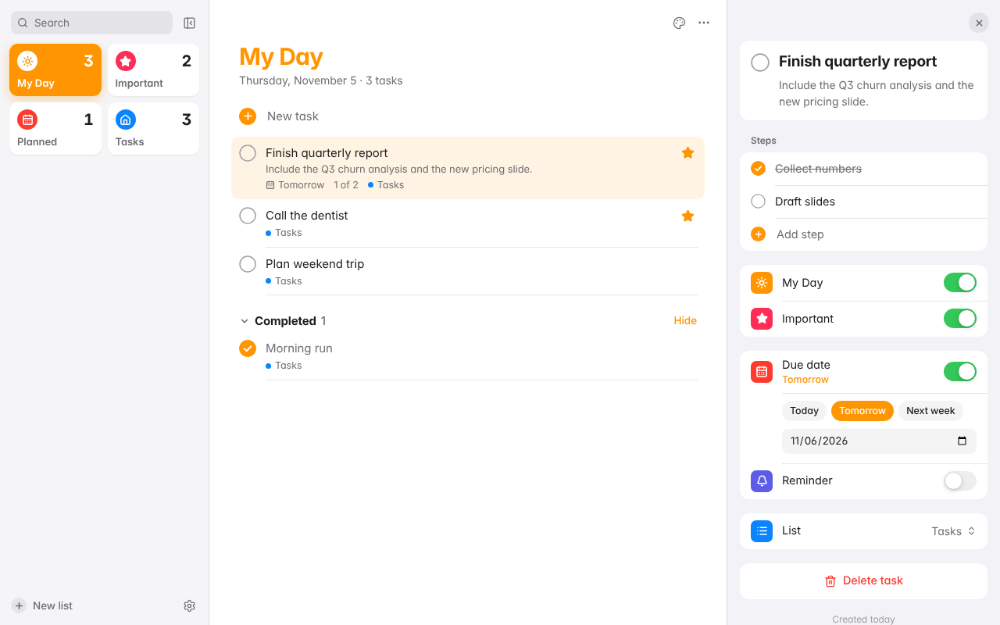
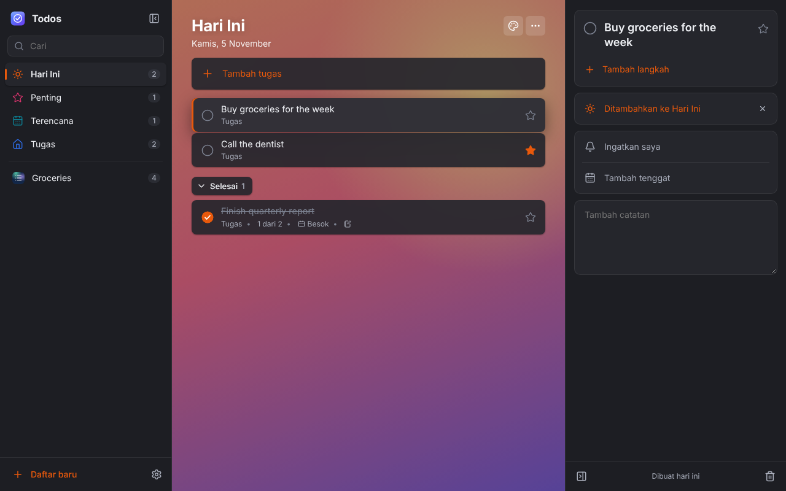

# Todos

A fast, clean to-do app with an Apple-inspired design. It runs on **Windows, macOS and Linux** (every distro, Arch included) and is built with **Rust + Tauri v2**. The UI is written in Svelte 5.

> 🇮🇩 [Baca dalam Bahasa Indonesia](#-bahasa-indonesia)




## Features

- **Smart lists**: *My Day* (clears itself every day), *Important*, *Planned* (grouped by Earlier / Today / Tomorrow / This week / Later) and *Tasks*, plus as many custom lists as you want.
- **Task details**: steps (sub-tasks, which can be promoted to full tasks), due dates, reminders that show **native desktop notifications**, notes, an important flag and *Add to My Day*.
- **Design**: Apple-inspired UI with San Francisco on macOS and bundled Inter elsewhere, smart-list tiles, inset-grouped inspector with switches, translucent menus and HUD toasts. On macOS the window uses an overlay title bar.
- **Personalization**: light, dark or system appearance. 12 system colors and 29 icons per list, plus a color per smart list.
- **Interaction**: drag-and-drop to reorder tasks and lists, a right-click context menu, search across titles, notes and steps, undo after deleting, a completion sound and smooth animations.
- **Keyboard shortcuts**: `Ctrl/⌘+N` new task, `Ctrl/⌘+L` new list, `Ctrl/⌘+F` search, `Ctrl/⌘+D` complete, `Ctrl/⌘+T` My Day, `Ctrl/⌘+I` important, `Del` delete, `↑/↓` move the selection, `Ctrl/⌘+1…4` switch smart list, `Ctrl/⌘+B` sidebar, `Ctrl/⌘+,` settings. The full list is in Settings.
- **Two languages**: English and Bahasa Indonesia, switchable in Settings.
- **Local and private**: everything is stored in a local SQLite database:
  - Linux: `~/.local/share/com.iniandrew.todos/todos.db`
  - macOS: `~/Library/Application Support/com.iniandrew.todos/todos.db`
  - Windows: `%APPDATA%\com.iniandrew.todos\todos.db`

## Backup & restore

There is no cloud sync. Your data is a local SQLite database. In **Settings → Data** you can:

- **Export backup**: a `todos-backup-YYYY-MM-DD.json` file with all lists, tasks, steps and settings. Use it to move data to another computer.
- **Export to CSV**: open your tasks in Excel, Numbers or Google Sheets. This is export only.
- **Import backup…**: shows what's in the file, then lets you **Merge** (add/update, never deletes) or **Replace all**. Before a replace, a safety copy of your current data is written automatically.
- **Daily automatic backup** (on by default): keeps the last 7 days in `<data folder>/backups/`. Restore one with **Restore automatic backup**, and use **Open data folder** to find the files.

## Architecture

```
src/                 Svelte 5 + TypeScript UI
  lib/api.ts         typed bridge to Rust (falls back to a localStorage mock in a normal browser)
  lib/store.svelte.ts  app state (Svelte runes)
  lib/i18n/          en / id dictionaries
  components/        Sidebar, TaskListView, TaskItem, DetailPanel, Settings, …
src-tauri/           Rust backend
  src/db.rs          SQLite schema, migrations, all queries (+ unit tests)
  src/backup.rs      JSON export/import, CSV export, daily auto-backups (+ unit tests)
  src/commands.rs    #[tauri::command] handlers
  src/reminders.rs   background thread → desktop notifications
packaging/arch/      PKGBUILDs for Arch Linux (source build + todos-bin)
packaging/linux/     .desktop file and portable tarball script
.github/workflows/   CI + cross-platform release builds
```

## Development

### Prerequisites

- [Rust](https://rustup.rs) (stable)
- Node.js 20+ and [pnpm](https://pnpm.io) 10+
- System libraries for your OS:

| OS | Install |
| --- | --- |
| **Debian / Ubuntu / Mint** | `sudo apt install libwebkit2gtk-4.1-dev libgtk-3-dev librsvg2-dev libayatana-appindicator3-dev build-essential curl wget file libssl-dev` |
| **Arch / Manjaro / EndeavourOS** | `sudo pacman -S --needed webkit2gtk-4.1 gtk3 librsvg libayatana-appindicator base-devel curl wget file openssl` |
| **Fedora** | `sudo dnf install webkit2gtk4.1-devel gtk3-devel librsvg2-devel libappindicator-gtk3-devel openssl-devel @development-tools` |
| **openSUSE** | `sudo zypper in webkit2gtk3-soup2-devel gtk3-devel librsvg-devel libappindicator3-1 openssl-devel -t pattern devel_basis` |
| **macOS** | `xcode-select --install` |
| **Windows** | [Microsoft C++ Build Tools](https://visualstudio.microsoft.com/visual-cpp-build-tools/) ("Desktop development with C++"). WebView2 already ships with Windows 10/11. |

### Run

```bash
pnpm install
pnpm tauri dev
```

`pnpm dev` runs only the web UI at <http://localhost:1420>. Data is then kept in `localStorage`, which is handy for working on the UI.

### Test and lint

```bash
pnpm check                                   # svelte-check / TypeScript
cd src-tauri && cargo test && cargo clippy   # Rust unit tests + lints
```

## Building installers

```bash
pnpm tauri build
```

The installers end up in `src-tauri/target/release/bundle/`:

| Platform | Output |
| --- | --- |
| Windows | `.msi`, `-setup.exe` (NSIS) |
| macOS | `.app`, `.dmg` (`pnpm tauri build --target universal-apple-darwin` builds a universal Intel + Apple Silicon app) |
| Linux | `.deb`, `.rpm`, `.AppImage` (the AppImage runs on almost every distro). The release workflow also uploads a portable `.tar.gz` (`packaging/linux/make-tarball.sh`) |

To build only some formats, pass e.g. `pnpm tauri build --bundles deb,appimage`.

### Arch Linux

**Prebuilt (`todos-bin`, no compiling)** installs the portable binary from the latest release:

```bash
cd packaging/arch/todos-bin
makepkg -si
```

**From source** builds with Rust and pnpm:

```bash
cd packaging/arch
makepkg -si
```

You can also use the AppImage, or the portable tarball `todos-<version>-linux-x86_64.tar.gz` from a release. Extract it and run `./todos`. The tarball needs `webkit2gtk-4.1`, `gtk3` and `libnotify` installed.

### Automated releases

Pushing a tag like `v0.1.0` starts `.github/workflows/release.yml`. It builds on Windows, macOS (universal) and Linux, and attaches every installer to a draft GitHub release.

---

## 🇮🇩 Bahasa Indonesia

**Todos** adalah aplikasi to-do yang cepat dan bersih, dengan desain terinspirasi Apple. Aplikasi ini jalan di **Windows, macOS, dan Linux** (semua distro, termasuk Arch), dibuat dengan **Rust + Tauri v2**, dan UI-nya memakai Svelte 5.

### Fitur

- **Smart list**: *Hari Ini* (kosong lagi setiap hari), *Penting*, *Terencana* (dikelompokkan per tanggal), dan *Tugas*, plus daftar buatan sendiri sebanyak yang kamu mau.
- **Detail tugas**: langkah (sub-tugas), tenggat, pengingat dengan **notifikasi desktop**, catatan, tanda penting, dan *Tambahkan ke Hari Ini*.
- **Desain**: gaya Apple: font San Francisco di macOS (Inter di OS lain), tile smart list, panel detail bergaya iOS Settings dengan switch, menu transparan, dan toast HUD.
- **Personalisasi**: tampilan terang, gelap, atau ikut sistem. Ada 12 warna dan 29 ikon per daftar.
- **Interaktif**: drag & drop untuk mengurutkan, menu klik kanan, pencarian, *undo* setelah menghapus, suara saat tugas selesai, dan animasi halus.
- **Pintasan keyboard**: daftar lengkapnya ada di Pengaturan.
- **Dua bahasa**: English dan Bahasa Indonesia, bisa diganti di Pengaturan.
- **Data lokal**: semua tersimpan di database SQLite di komputermu sendiri.

### Backup & restore

Belum ada sync cloud, jadi semua data tersimpan di database SQLite lokal. Di **Pengaturan → Data** kamu bisa:
- **Ekspor cadangan** ke file JSON, untuk memindahkan data ke komputer lain.
- **Ekspor ke CSV** untuk dibuka di Excel atau Google Sheets.
- **Impor cadangan** dengan pilihan **Gabungkan** atau **Ganti semua**. Sebelum mengganti, salinan pengaman data sekarang disimpan otomatis.
- **Cadangan otomatis harian** menyimpan 7 hari terakhir dan bisa dipulihkan dari menu yang sama.

### Menjalankan

1. Install Rust, Node.js 20+, pnpm, dan library sistem (lihat tabel *Prerequisites* di atas).
2. Jalankan:

```bash
pnpm install
pnpm tauri dev
```

### Membuat installer

```bash
pnpm tauri build
```

Hasilnya ada di `src-tauri/target/release/bundle/`: `.msi`/`.exe` untuk Windows, `.dmg`/`.app` untuk macOS, serta `.deb`/`.rpm`/`.AppImage` untuk Linux. Untuk Linux tersedia juga tarball portabel `todos-<versi>-linux-x86_64.tar.gz` (sekitar 3 MB). Ekstrak lalu jalankan `./todos`.

Pengguna Arch bisa memilih:
- `packaging/arch/todos-bin` (`makepkg -si`): pakai binary siap pakai dari release, tanpa compile.
- `packaging/arch` (`makepkg -si`): build dari source.
- AppImage dari release.

Push tag `v*` (misalnya `v0.1.0`) ke GitHub untuk membuat installer semua platform secara otomatis lewat GitHub Actions.
